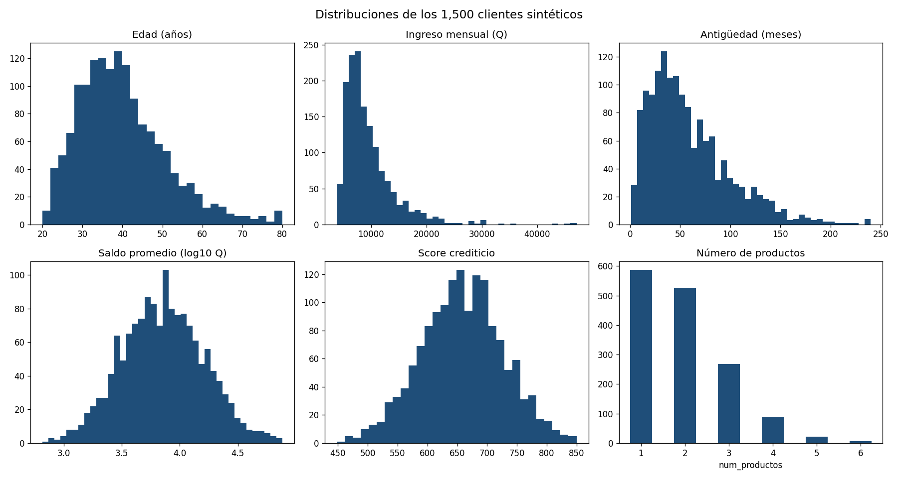
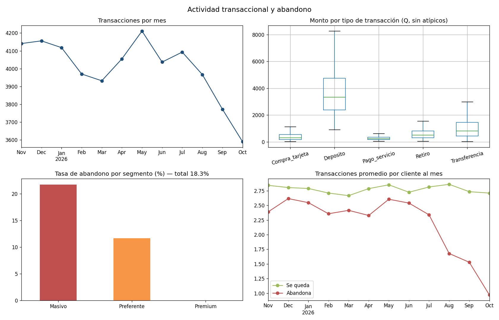

# Reporte de validación de datos sintéticos

- Clientes: **1,500** | Transacciones: **48,042** | Interacciones: **3,095**
- Ventana observada: 2025-11-01 a 2026-10-31
- Tasa de abandono: **18.3%**

> Las ALERTAS de nulos y duplicados son esperadas: se simularon errores típicos
> de los sistemas fuente y se corrigen en la capa Silver.

## Resultados

| Revisión | Tabla | Detalle | Resultado |
|---|---|---|---|
| Conteo | clientes | 1,500 registros (mínimo 1,000) | OK |
| Conteo | transacciones | 48,042 registros | OK |
| Conteo | interacciones | 3,095 registros | OK |
| Rango | clientes | edad entre 18 y 80: 0 fuera de rango | OK |
| Rango | clientes | ingreso_mensual entre 3,600 y 80,000: 0 fuera de rango | OK |
| Rango | clientes | antiguedad_meses entre 1 y 240: 0 fuera de rango | OK |
| Rango | clientes | num_productos entre 1 y 6: 0 fuera de rango | OK |
| Rango | clientes | tiene_tarjeta_credito entre 0 y 1: 0 fuera de rango | OK |
| Rango | clientes | tiene_prestamo entre 0 y 1: 0 fuera de rango | OK |
| Rango | clientes | saldo_promedio entre 0 y 5,000,000: 0 fuera de rango | OK |
| Rango | clientes | score_crediticio entre 300 y 850: 0 fuera de rango | OK |
| Rango | clientes | abandono entre 0 y 1: 0 fuera de rango | OK |
| Rango | transacciones | monto entre 10 y 500,000: 0 fuera de rango | OK |
| Rango | interacciones | resuelta entre 0 y 1: 0 fuera de rango | OK |
| Rango | transacciones | fecha entre 2025-11-01 y 2026-10-31: 0 fuera | OK |
| Rango | interacciones | fecha entre 2025-11-01 y 2026-10-31: 0 fuera | OK |
| Categorías | clientes | genero: 0 valores no válidos | OK |
| Categorías | clientes | segmento: 0 valores no válidos | OK |
| Categorías | clientes | departamento: 0 valores no válidos | OK |
| Categorías | clientes | canal_preferido: 0 valores no válidos | OK |
| Categorías | transacciones | tipo: 0 valores no válidos | OK |
| Categorías | transacciones | canal: 0 valores no válidos | OK |
| Categorías | interacciones | tipo: 0 valores no válidos | OK |
| Categorías | interacciones | canal: 0 valores no válidos | OK |
| Nulos | clientes | ingreso_mensual: 15 (1.0%), canal_preferido: 15 (1.0%) | ALERTA |
| Nulos | transacciones | canal: 147 (0.3%) | ALERTA |
| Nulos | interacciones | sin nulos | OK |
| Duplicados | clientes | 0 cliente_id repetidos | OK |
| Duplicados | transacciones | 239 transaccion_id repetidos | ALERTA |
| Duplicados | interacciones | 0 interaccion_id repetidos | OK |
| Integridad | transacciones | 0 registros sin cliente existente | OK |
| Integridad | interacciones | 0 registros sin cliente existente | OK |

## Estadísticas descriptivas (clientes)

| Variable | Media | Mín | Mediana | Máx |
|---|---|---|---|---|
| edad | 39.6 | 20 | 38 | 80 |
| ingreso_mensual | 9,562.1 | 3,808 | 8,182 | 47,109 |
| antiguedad_meses | 58.8 | 1 | 49 | 240 |
| num_productos | 2.0 | 1 | 2 | 6 |
| saldo_promedio | 10,043.7 | 657 | 7,239 | 76,191 |
| score_crediticio | 658.5 | 448 | 659 | 850 |

## Distribuciones

